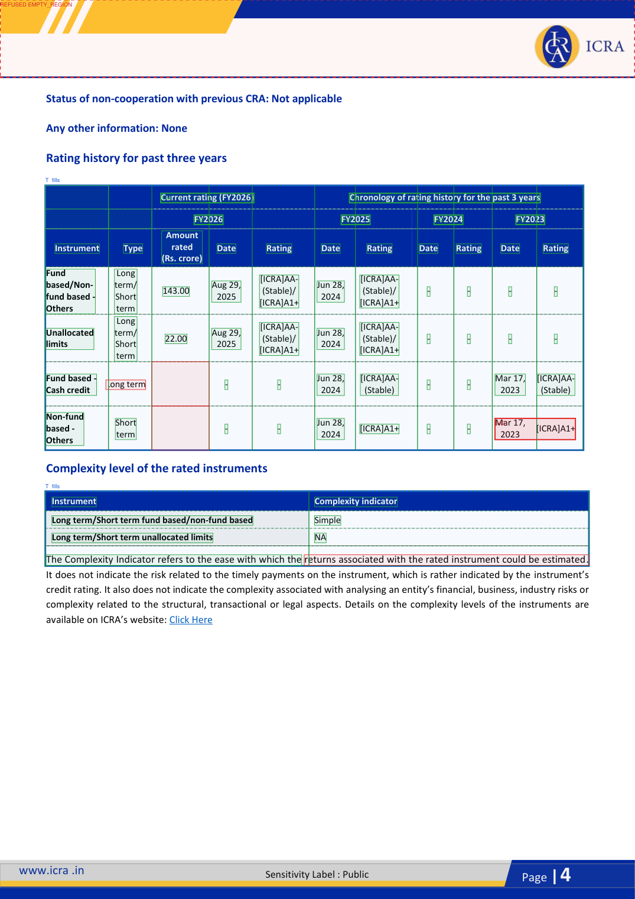
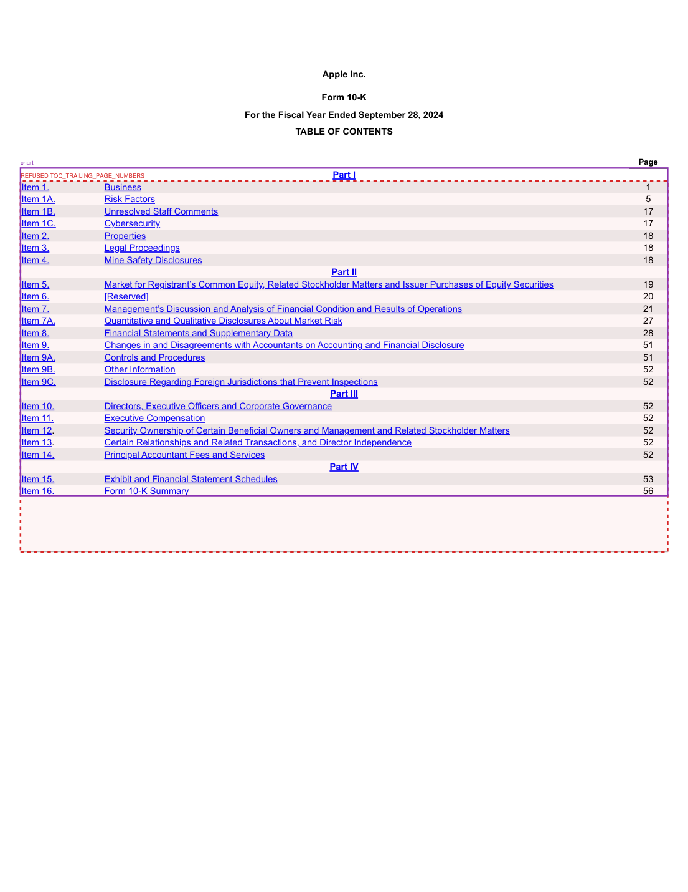
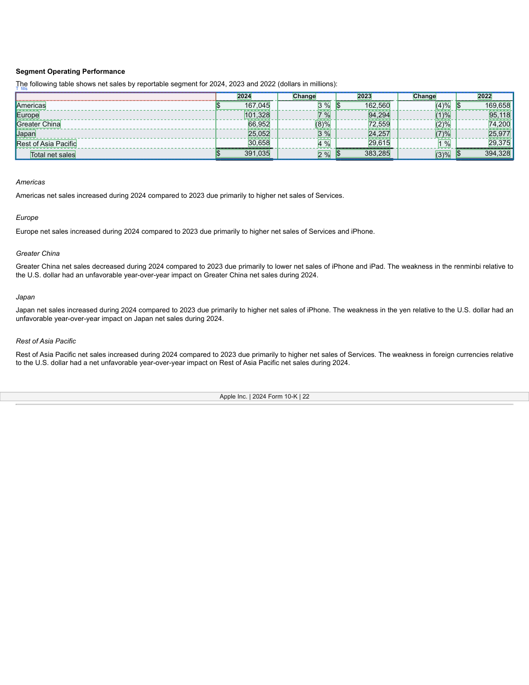
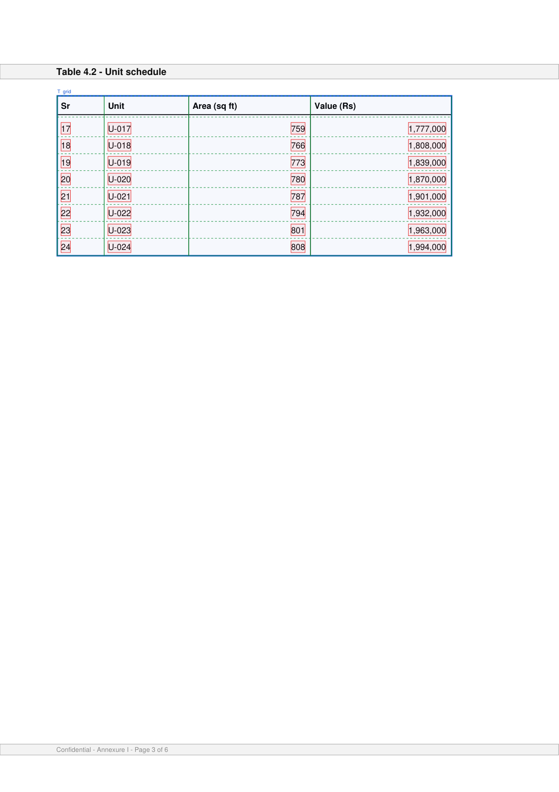
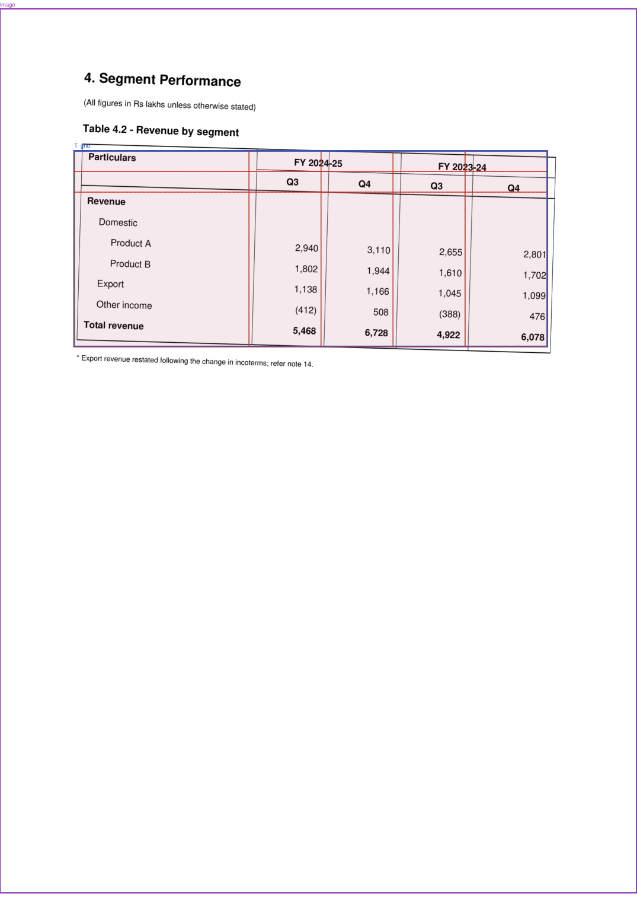

# ARCHITECTURE

Stage-by-stage design. Every non-obvious choice has a matching entry in
[DECISIONS.md](DECISIONS.md); every known failure is in
[LIMITATIONS.md](LIMITATIONS.md).

---

## The shape of the pipeline

```
                     ┌─────────────────────────────────────────────┐
  doc.pdf ─────────► │ S1  intake: page typing, deskew, rotation   │
                     └──────────────────┬──────────────────────────┘
                                        │  PageText (tokens, geometric lines)
                     ┌──────────────────▼──────────────────────────┐
                     │ S2  layout (provisional roles)              │
                     │     running header/footer, headings,        │
                     │     captions, footnotes, scale notes        │
                     └──────────────────┬──────────────────────────┘
                                        │
              ┌─────────────────────────┼─────────────────────────┐
              ▼                         ▼                         ▼
   ┌────────────────────┐  ┌────────────────────┐  ┌────────────────────┐
   │ S3a ruled          │  │ S3b borderless     │  │ S3c trap rules     │
   │  rules · dots      │  │  projection        │  │  TOC · index ·     │
   │  cell fills        │  │  profile gutters   │  │  prose · callout   │
   │  rule breakpoints  │  │  side-by-side      │  │                    │
   └─────────┬──────────┘  └─────────┬──────────┘  └─────────┬──────────┘
             └───────────────┬───────┴───────────────────────┘
                             ▼
                  ┌─────────────────────────┐
                  │ S3d arbitration         │  ── refusals ──► rejected_regions
                  │  two-tier clustering    │
                  └──────────┬──────────────┘
                             │  Candidate (bbox + all evidence, kept per source)
                  ┌──────────▼──────────────┐
                  │ S2′ demote_in_regions   │  (roles corrected, section tree built)
                  └──────────┬──────────────┘
                  ┌──────────▼──────────────┐
                  │ S4 structure            │
                  │  weighted boundaries    │
                  │  row-source selection   │
                  │  spans · header levels  │
                  │  indent hierarchy       │
                  └──────────┬──────────────┘
                  ┌──────────▼──────────────┐
                  │ S5 cells                │
                  │  text layer / per-cell  │
                  │  OCR (fails closed)     │
                  └──────────┬──────────────┘
                  ┌──────────▼──────────────┐
                  │ S6 stitch (2 gates +    │
                  │    5 weighted signals)  │
                  └──────────┬──────────────┘
        ┌────────────────────┼────────────────────┐
        ▼                    ▼                    ▼
┌───────────────┐  ┌──────────────────┐  ┌──────────────────┐
│ S7 normalise  │  │ S8 context       │  │ S9 confidence    │
│  types, scale │  │  title, section, │  │  14 signals      │
│  negatives    │  │  units, footnote │  │  reconciliation  │
│  refusals     │  │  figure linking  │  │  calibration     │
└───────┬───────┘  └────────┬─────────┘  └────────┬─────────┘
        └───────────────┬────┴─────────────────────┘
                        ▼
        ┌───────────────────────────────────┐
        │ S10 persist   extraction.db       │
        │               tables/*.xlsx       │
        │               manifest.json       │
        │               review_queue.csv    │
        │ S11 audit     debug/page_NNN.png  │
        └───────────────────────────────────┘
```

Two departures from the brief's numbering, both deliberate:

**S2 runs twice.** Layout segmentation must happen *before* detection, because the
detectors need running headers excluded — but it cannot *finish* before detection,
because a bold table header row is indistinguishable from a section heading until you
know a table is there. So S2 assigns provisional roles, S3 detects, and
`demote_in_regions` corrects the roles before the section tree is built. Without the
second pass the ICRA rating table's `section_path` ended in `"Others"` — half of a
cell.

**S7 is fed by a document-level pre-pass.** Day/month order is a property of a
document, not a cell, so every date-shaped string is observed before any cell is
normalised. That also keeps normalisation deterministic: the answer cannot depend on
which cell happens to be processed first.

---

## S1 — Intake and page typing

Per page, never per document. Classification uses text-layer glyph count, raster area
coverage and character density; the result is `digital`, `scanned`, `hybrid` or
`empty`. On the Apple 10-K that yields 119 digital, 1 hybrid (the stock-performance
chart page) and 1 empty (an exhibit divider) — which is exactly right, and a
document-level verdict would have called all 121 pages digital and never looked at the
chart.

**Skew estimation** is a sheared projection-profile search. The textbook method rotates
the image at each candidate angle and scores the horizontal projection; that is one
image rotation per angle. Instead we take the ink pixel coordinates once and, per
angle, shear them (`y' = y − x·tan a`) and histogram with `np.bincount`. Same
objective, no interpolation, ~50× faster, and exactly reproducible because it never
touches a resampling filter.

The search resolution matters more than the objective. A 1° coarse scan walked straight
past a real 1.6° skew whose peak was 1.83× the unskewed score, because at 200 dpi the
projection peak is well under a degree wide. The scan is now 0.25° coarse, 0.1° fine.

---

## S2 — Layout, and the running-header problem

The brief calls repeating headers "a classic source of false positives". Measuring the
samples showed the textbook implementation is not enough:

| document | running chrome | y position | found by band test? |
|---|---|---|---|
| ICRA report | `www.icra.in  Sensitivity Label : Public  Page \| 3` | y=810, fixed | yes |
| Apple 10-K | `Apple Inc. \| 2024 Form 10-K \| 22` | y=510…642, **floats with content** | no |

The Apple footer appears on 57 pages but never inside the bottom 14% band and never at
a stable y, because the HTML-to-PDF converter places it immediately after the content.
So candidates come from the union of a **geometric** view (inside the top/bottom band)
and a **structural** one (the first/last three lines of the page, wherever they sit),
and the key is `(shape, side)` with no y quantisation — `norm_for_repeat` collapses
digit runs so `Page | 7` and `Page | 12` collide.

Two guards stop it eating a repeated *table* header, which would be a silent
catastrophe:

1. **Isolation** — a running header is separated from the body by more than 1.5 line
   gaps; a repeated table header is immediately followed by its data rows.
2. **Stability or extremity** — either the y is stable across pages, or the line is
   structurally first/last on most of its pages.

And if S3 later finds a "chrome" line inside a table region anyway, the label is taken
back and a `CHROME_INSIDE_TABLE` issue is recorded — the mistake becomes visible rather
than silent.

---

## S3 — Detection: three regimes, not two

The brief asks for two detectors. Measuring the samples first showed there are **three
different ways a PDF expresses a grid**, and only one of them is drawn with lines:

| document | how the grid is expressed | what naive line-finding does |
|---|---|---|
| `Shell.pdf` | **dotted rules** — 18,066 filled rects of 0.72 × 0.72 pt | finds 18,000 "rules" of length 0.72 and no table |
| `Shell MRPL…pdf` | **horizontal hairlines only**, segmented per cell | finds 3-point fragments; no vertical rules exist at all |
| `Apple 10-K` | **per-cell background fills**, no rules whatsoever | finds nothing and falls back to whitespace |

So S3a emits *evidence* — rules, dots, cell fills, rule breakpoints, intersections —
rather than verdicts, and each region is tagged with the regime that found it
(`grid`, `fills`, `hlines`, `vlines`).

Two findings worth their own note:

**Rule breakpoints are a free, high-precision column signal.** The ICRA report's
hairlines arrive as `[43.2,248.8] [248.8,249.3] [249.3,319.8] …`. Merging across the
sub-point gaps rebuilds the full-width rule; the *breakpoints between segments* are the
author's own cell edges. There are no vertical rules on that page — this is precisely
the "ruled horizontally but not vertically" case the brief says neither classical
approach handles alone, and the breakpoints solve it exactly.

**Dots must vote on both axes.** A 0.72 pt square is thin in both directions, so it is
offered to both the horizontal and vertical clusterer and survives only if it merges
into a run longer than `rule_min_length`. A vertical dotted line contributes one dot
per horizontal cluster, so it cannot fake a horizontal rule. Dots are also barred from
producing breakpoints — treating each square's edge as a cell boundary produced 703
bogus breakpoints per page.

### S3b — borderless

The brief's sketch is right: vertical ink projection, keep minima persisting across
≥80% of rows. Two additions were needed.

*Prose must be removed before profiling, not filtered after.* Above the Apple segment
table sits "The following table shows net sales by reportable segment…". With eight
table rows below it, the persistence test still passes at 7/8 = 87%, so the sentence is
admitted as a row and every column shifts. A line is therefore classified as prose
first, on a signal that does not depend on the columns being sought.

*And prose means word-sized gaps, not merely uniform ones.* Testing only uniformity
("max gap < 3 × median") passes a numeric table row, because a row with five wide
column gaps has a wide median and three times it is wider still. That misread
`Term loan A  1,200  1,200  900  600  3,900` as prose and silently deleted two rows.
The test now requires the median gap to be at most 0.6 em as well.

### S3c — the traps

Each of the four traps keys on a *structural invariant* rather than on appearance:

| trap | invariant |
|---|---|
| table of contents | last token is a bare integer on ≥70% of rows, ascending, with ≤1.2 numbers per row right of the region midline |
| index / glossary | trailing tokens form a comma-separated page list **within one cell** (accumulated only across word gaps) |
| two-column prose | one gutter, ≥6 median words per cell both sides, ≥85% alphabetic, and rows that do not span both columns |
| bordered callout | a rectangle with ≤4 intersections and no interior |

Refusals are recorded in `rejected_regions`, drawn in red by the debug renderer, and
counted in `metrics.json`. "We correctly excluded the table of contents" is only a
checkable claim if the refusal is written down.

### S3d — arbitration

Every detection is a **vote for a region**. Votes are clustered spatially and one
candidate is emitted per cluster carrying the union of the evidence, *kept separate by
source* — `rule_x_lines`, `fill_x_lines`, `breakpoints`, `gutters` — because S4 weights
them differently and can only do that if it knows which is which.

Clustering is two-tier: author-drawn evidence (rules, fills) seeds the clusters, and
whitespace-inferred regions attach to at most one of them. A borderless region
overlapping two rule lattices is dropped rather than allowed to bridge them — that is
what keeps two side-by-side tables from becoming one. Strong clusters that are
*stacked* (contiguous in y, sharing x) do merge, because a shaded header block and a
shaded body block are one table.

Overlap is `max(IoU, containment)`, not IoU: the underline segments beneath Apple's
number columns have IoU 0.22 against their table but are 100% contained in it.

---

## S4 — Structure: one place resolves boundaries

Column boundaries come from a weighted vote:

| source | weight | why |
|---|---|---|
| vertical rule | 3.0 | drawn by the author; unambiguous |
| horizontal-rule breakpoint | 2.5 | the author's own cell edges, sub-point precise |
| cell background fill edge | 2.0 | exact, but only covers shaded rows |
| gutter centre | 1.0 | inferred; correct on average, drifts under right-aligned numbers |

then three vetoes, each of which was added in response to a measured failure:

- **straddle** — a boundary that cuts a glyph is wrong. Strong sources may be straddled
  by up to 12% of rows (text legitimately overflows a narrow cell); weak sources get
  zero tolerance. Header rows are excluded from the count, because a spanning header
  cell *must* cross the boundary it spans.
- **word gap** — a boundary never sits inside an ordinary space between two words of one
  cell. This is invisible to the straddle test: the offending boundary cut no glyph, it
  landed in the 2.4 pt gap between `non-fund` and `based`.
- **duplicate** — a gutter estimate within 4 pt of an already-chosen precise boundary is
  the same boundary.

Rows are different: **one source wins, they are never unioned.** More column evidence is
better, but every extra *y* boundary splits a row. Each source proposes a complete band
set and the most plausible one wins, scored on three components:

- `labelled` — fraction of bands with text in the first column;
- `tall_enough` — fraction at least 80% of a line high;
- `coherent` — fraction holding one row rather than several.

The third took two attempts. Counting "lines with text in ≥2 columns" fails, because
the ICRA rating table wraps four columns at once and one correct row contains five such
lines — indistinguishable from Apple's five real rows crammed into one band. What
separates them is **line pitch**, measured rather than guessed:

| case | pitch / glyph height |
|---|---|
| ICRA p4, one row wrapped over five lines | 0.613 |
| ICRA p1, one row wrapped over three lines | 0.607 |
| Apple p25, five separate rows | 1.194 |
| Apple p32, three separate rows | 1.268 |

Two clusters, nothing between 0.61 and 1.19, so the threshold sits at the midpoint
(0.90). It is a property of typesetting, not of a document.

**Adornment columns.** EDGAR puts the currency symbol in its own column: the Apple
segment table is geometrically `label │ $ │ 167,045 │ 3 │ % │ $ │ 162,560 │ …` — eleven
bands for six logical columns and five headers. Currency-only bands fold right into the
number (the symbol moving to `columns.unit`), percent-only bands fold left, empty and
sub-7 pt padding bands dissolve. The column count then matches the header count, which
is what makes `header_path` alignment possible at all. Folding never dissolves a
boundary backed by a drawn rule.

**Header rows** are found from the deepest horizontal rule in the top third that (a)
coincides with a band boundary and (b) survives validation: no row it would call a
header may already carry the body's dominant *coarse* value class. Deepest-without-
validation swallowed Apple's iPhone row; validation on exact format signatures was too
fine ("2,087.5" vs "6.4"); the label column has to be excluded from the comparison
entirely, because it is text on every row and would make "text" the dominant class.

**Header cells are split by word run, not by band.** `Current rating (FY2026)` is three
tokens with ordinary spacing that land in three different bands without straddling any
boundary, so the band-wise splitter emitted three one-column cells and `header_path`
came out as `["Current", "FY2026", …]`. Runs are then widened over adjacent empty bands
only while the text stays visually centred in the widened span.

**Indentation.** First-column left edges are clustered into levels and a stack turns
them into `row_label_path`. Total rows are excluded from the clustering and pinned to
level 0 — Apple centres "Total net sales" at x=35 while its data rows start at x=19, so
pure geometry made the total a *child* of "Rest of Asia Pacific".

---

## S5 — Cells

For a digital page the text layer *is* the answer; re-OCRing it can only lose
information. The work is assembling tokens faithfully and recording what was noticed:
wrapping, superscript footnote markers, ligature expansion, watermark overlap,
straddling.

Cell text is assembled **line by line, not by x order**. The ICRA header cell
`Previous rated / amount / (Rs. crore)` came out as
`Previous (Rs. amount crore) rated` when tokens were joined by x.

For a raster region we OCR **the cell crop, not the page** — cropping first is what
makes per-cell confidence meaningful. The backend is pluggable and **fails closed**:
with no engine installed a cell is written with `raw_text = NULL`, `source = 'none'`,
confidence 0 and an `OCR_UNAVAILABLE` issue. One repair is permitted — undoing glyph
confusions (`O→0`, `l→1`, `S→5`) in a numeric column — under a condition that makes it
safe: it only ever turns a non-number into a number, so it can never rewrite one valid
number into a different valid number.

---

## S6 — Stitching: the rule, and its defence

Two hard gates, which no score can buy past:

1. **Adjacent pages.** A table cannot resume after an unrelated page; allowing gaps
   merges the receivables schedule on page 12 with the payables schedule on page 15
   whenever their shapes match, and that error is invisible.
2. **Same column count, and the interior boundaries line up** (≥85% within 6 pt).

Then a weighted score over five soft signals (threshold 0.62): boundary alignment 0.30,
header repeated-or-absent 0.20, `(Contd.)` marker 0.15, no intervening heading 0.20,
first-column type continuity and page-edge position 0.15.

**Why interior boundaries and not band IoU.** Band IoU was the obvious measure and it is
the wrong one: a table's outer edges are set by whatever its widest cell happens to be,
so a page carrying the repeated header is wider than a page without it. On the six-page
fixture that alone dragged mean band IoU to 0.79 against a 0.85 gate and split one
logical table into six. The interior boundaries drift by only the point or two the brief
warns about. Band IoU is still recorded in the vote for transparency.

**Why weights and not a decision tree.** Every individual signal is absent on some real
document — the brief says so: sometimes the header repeats, sometimes not; sometimes
there is a `(Contd.)`, usually not. A tree inherits the blind spot of whichever signal
it interrogates first. A weighted sum degrades gracefully, and the score plus every
component goes into `stitch_votes_json`.

**Header de-duplication** compares against the logical table's *first* part, not the
immediately preceding one. On the six-page fixture the header repeats on pages 1, 3 and
5; comparing page 3 against page 2 (whose first row is data) detected no repeat and
duplicated two header rows into the data — exactly the failure the brief calls out.

---

## S7 — Normalisation: additive, and willing to refuse

`raw_text` is always kept exactly. Everything else is a second opinion carrying flags.
Three cases become refusals rather than guesses:

| input | verdict |
|---|---|
| `1.234,56` | `AMBIGUOUS_DECIMAL_SEPARATOR`, value null — one cell cannot tell continental from Western |
| `03/04/2024` | `AMBIGUOUS_DATE_ORDER`, value null — until an unambiguous date elsewhere establishes the document's order |
| `12,345,67` | parsed, but flagged `AMBIGUOUS_GROUPING` — matches neither Indian nor Western convention |

`#REF!` is typed `error`, never coerced. `-`, `–`, `Nil`, `NA`, `0` and empty are five
distinct value types, because they mean five different things to an accountant. A
numeric parse is only attempted on a numeric-shaped string — without that gate every
prose cell containing a comma came back `MALFORMED_NUMBER`, producing 375 bogus
mandatory flags on the Apple 10-K.

Header cells keep `raw_text` and a `value_type` but carry **no** `normalized_value`: a
header is a label, and emitting `2024.0` for the column headed "2024" invites a
consumer to sum a column label.

---

## S8 — Context

Scale resolution walks outward from the table and records where it stopped: table
header cells → caption → lines above the region → section heading → earlier pages (up
to `scale_search_pages`). Confidence decays with distance, and the source and page are
stored, because a unit inherited from two pages back is a materially weaker claim than
one in the table's own caption.

Footnote markers are matched against footnote lines on the table's page **and the
following one** — item 10 of the adversarial set puts the footnote text on the next
page. Links are stored cell-to-footnote, not table-to-page.

Table-to-figure association is an explicit weighted sum: textual reference 0.45, shared
section numbering 0.25, proximity within the same section 0.20, position before the next
heading 0.10. Textual reference dominates because it is the only signal that is *stated*
rather than inferred; proximity alone caps at 0.30, deliberately below any threshold a
consumer should trust. Page furniture is suppressed by the same repetition test that
finds running headers — the ICRA logo is an image block on all seven pages at the same
coordinates, and grouping by colour alone once produced a "table" whose bbox was the
whole page.

---

## S9 — Confidence, and the mechanical guarantee

Fourteen deterministic signals per cell (source, OCR confidence, grid-snap residual,
straddling, type conformity, digit-count anomaly, multi-line, cross-foot, down-foot,
header/body column mismatch, duplicate row, watermark overlap, empty-in-dense-row, grid
support) are combined with **fixed, documented logistic weights** and mapped to a
probability through a curve **fitted offline** and vendored as `calibration.json`.
Fitting offline is what lets the number be a probability without making the run
non-deterministic.

Signals are only half of it. Some conditions mean *we know we might be wrong*, and no
amount of corroborating evidence should outvote them. Those are
`MANDATORY_REVIEW_CODES`, and they do two things:

- confidence is **hard-capped** below `high_confidence_floor`, so such a cell can never
  ship as high-confidence whatever the logistic says;
- the cell enters the review queue **regardless of the 8% budget**.

That is the mechanism behind "every cell is either correct or flagged". A budget able to
evict a known-suspect cell would make the 8% figure a lie, so the budget governs only
the discretionary tail of the ranking.

**Reconciliation tolerance is derived from printed precision, not from a percentage.**
With `tol = 0.5%` of the stated value, a subtotal of 359 against addends summing to 360
passes — and that is the deliberate typo the brief plants. What bounds an *innocent*
discrepancy is the precision the values are printed to: each addend can hide at most
half of its last displayed digit, so `n` addends accumulate at most `n · 0.5 · 10⁻ᵈ`.
Three values printed as 33.3 summing to 99.9 against a stated 100.0 still passes.

Down-foot contributors are the rows since the previous total at the *shallowest* indent
level in that window, which is what makes it work on a hierarchy. Cross-foot runs only
when a column header declares itself a total — summing "the other numeric columns" is
nonsense on a year-over-year table. Percentage columns are never addends. A row label
that reads as a total but contains a ratio ("Total outside liabilities/Tangible net
worth (times)") is excluded, and so is any "total" smaller than its largest addend.

---

## S10 / S11 — Persistence and audit

SQLite with the brief's minimum schema verbatim plus additive columns, one `.xlsx` per
logical table with the four required sheets, `manifest.json`, `review_queue.csv`
(plus the full ranking for the PR curve), `metrics.json`, `assets/*.png`,
`debug/page_NNN.png`, `logs/run.jsonl`.

Two details that are easy to miss:

- **Byte-identical Excel.** `openpyxl` stamps `docProps/core.xml` and every zip entry
  with `datetime.now()`, so two runs differ in dozens of bytes even when every cell
  matches. The workbook properties are pinned and the archive is rebuilt with a constant
  timestamp.
- **Native types only where trusted.** A value is written as a native Excel number or
  date only when its cell is not flagged, so a spreadsheet `SUM` can never quietly
  incorporate a value the pipeline does not stand behind.

The debug renderer draws what the pipeline *believed*: accepted regions in blue,
**refused** regions in red with the trap code, column boundaries solid green and row
boundaries dashed, every cell tinted by confidence (green ≥ floor, amber ≥ 0.60, red
below), merged cells outlined with their span, chrome bands greyed, assets in purple.
`gridsmith debug --out ./out --page 42` rebuilds it straight from the database.

---

## Reading the debug renders

Six representative renders are committed under `docs/renders/` (the `out_*/`
directories themselves are build output and gitignored). Regenerate the full set
with `python metrics/run_all.py`, or one page with
`gridsmith debug --out ./out --page N`.

### The three-level header — `docs/renders/icra_p004_three_level_header.png`



What to look at:

- **Two blue regions**, `T004 fills` and `T005 fills`, correctly separated — the
  rating-history table and the complexity table are 18 pt apart while the rating table's
  own row pitch is 44 pt, so no gap threshold could have split them. The breakpoint
  signature did (S3a `_split_stack`).
- **The red dashed box at the top** is the page banner, refused `EMPTY_REGION`. This is
  what a correct refusal looks like: proposed, examined, rejected, recorded.
- **The header** reads `Instrument │ Type │ Amount rated (Rs. crore) │ Date │ Rating │
  Date │ Rating │ …` across 11 columns, with `FY2026`, `FY2025`, `FY2024`, `FY2023`
  each spanning its Date/Rating pair one level up, and the two level-1 groups above
  that.
- **Two cells outlined in red** are the two low-confidence cells on the page: `Long term`
  in row 3's Type column, and `Mar 17, 2023` in the last row where a cell merge went
  wrong. Both are in `review_queue.csv`. The mistakes are *visible*, which is the point.
- **`T005` has a fourth row** containing the explanatory sentence below the table —
  paragraph closure did not reach it. Also flagged, also in the queue, and recorded in
  LIMITATIONS L3.

### A refusal — `docs/renders/apple_p003_refused_toc.png`



The table of contents. Alternating row shading means the fill detector proposes a clean
seven-column lattice, so this *had* to be refused by a rule rather than missed by the
detector. The render shows it in red with `TOC_TRAILING_PAGE_NUMBERS`, and the recorded
evidence reads "23 of 26 rows end in a bare integer, 100% of them ascending, median 1.0
numbers per row". Both baselines extract it as a table.

### Adornment folding — `docs/renders/apple_p025_adornment_folding.png`



The segment table. Eleven geometric bands (`label │ $ │ 167,045 │ 3 │ % │ …`) are drawn
as six columns, because the currency-only and percent-only bands have been folded into
their neighbours and `USD` moved to `columns.unit`. The green boundaries are where the
folding landed, not where the fill rectangles were.

### A dropped repeated header — `docs/renders/f2_p003_dropped_repeated_header.png`



Page 3 of the six-page fixture carries a repeated header. The render shows the region
starting at the *data*, because that header row was matched against the logical table's
first part and dropped — `dropped_repeated_header_rows` records it as `[[2, 0], [4, 0]]`.

### Failing closed — `docs/renders/f8_p001_scanned_fails_closed.png`



The scanned page, after deskewing by 1.55°. Structure *is* recovered — morphological
rule extraction finds 23 intersections and the grid is rebuilt from that lattice alone
(`build_grid_from_lattice`), because every other path in S4 needs tokens and this page
has none. All 15 cells are tinted red: with no OCR engine each carries `raw_text = NULL`,
confidence 0 and an `OCR_UNAVAILABLE` issue, and all 15 are in the review queue.
Nothing was guessed.

Three separate bugs had to be fixed before this worked, each of which silently discarded
correct work downstream of itself: the raster rule threshold demanded a run spanning 55%
of the *page* (so no column separator could ever qualify); arbitration rejected the region
as `EMPTY_REGION` because its content check reads the text layer; and `build_grid`
returned an empty grid for want of text lines. Structure was being found and thrown away
three times over.
